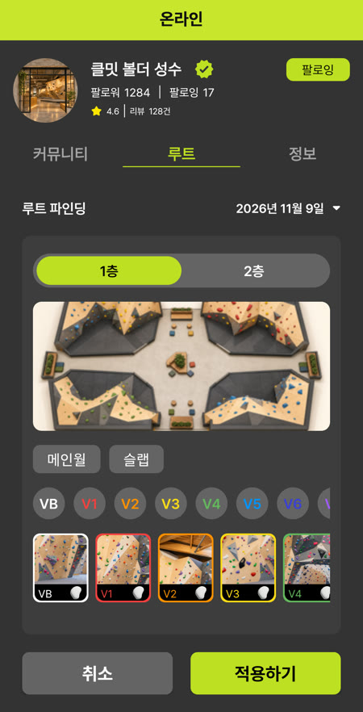
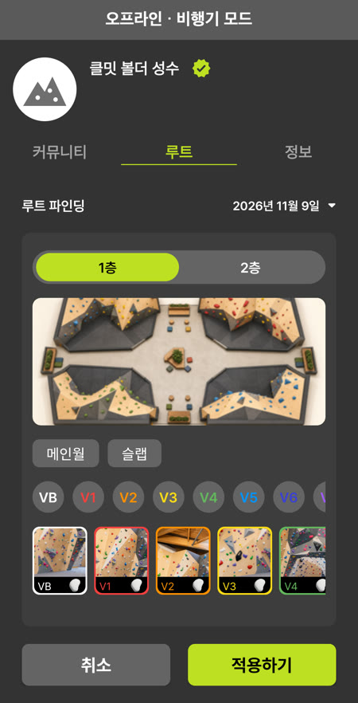

# Climeet Android Offline

  

클밋은 클라이밍 암장의 루트를 조회하고 운동을 기록하는 Android 앱입니다. 해당 앱의 오프라인 우선 구조 개선 작업을 진행 중입니다.

> 2024년 [팀 프로젝트](https://github.com/TheClimeet/climeet-android)의 기획과 화면을 바탕으로 한 개인 저장소입니다.

 

## 루트 조회 캐시

암장 프로필, 캘린더 기록, 실시간 기록, 쇼츠 섹터 선택의 네 화면은 같은 루트 API를 각자 호출했습니다. 그래서 이미 조회한 루트도 재진입할 때마다 서버 응답을 기다렸고, 변경이 없는 데이터도 매번 다시 받았습니다. 루트 조회를 Room 기반 Repository 하나로 통합하고, 재진입하면 캐시된 루트 카탈로그(층, 섹터, 난이도, 루트 목록)를 먼저 표시하도록 바꿨습니다.

### 측정 결과

| TTL 안 재진입 | 서버 요청 | 표시 시간 P50 |
| --- | ---: | ---: |
| 적용 전 | 3회 | 622ms |
| 적용 후 | **0회** | **510ms** (−18.0%) |

- TTL이 지난 뒤 재진입하면 ETag로 변경 여부만 확인해 요청이 3회에서 1회로 줄었습니다.

수치는 암장 프로필 루트 탭 재진입 기준이며, 캐시 적용 전후 빌드에서 조건별로 50회씩 측정했습니다. 측정 기준과 회차별 결과는 [측정 결과 문서](docs/offline-first/route-cache/README.md)에 있습니다.

### 오프라인 동작

오프라인에서도 홈에서 루트 탭까지 캐시된 카탈로그로 들어갈 수 있습니다.

| 서버에서 받은 카탈로그 | 내 암장을 눌러 진입 | 캐시된 카탈로그로 같은 목록 |
| :---: | :---: | :---: |
|  |  |  |

 

## 캐시 설계

화면은 Room에 캐시된 카탈로그만 읽고, 서버 통신은 Repository가 맡습니다.

### 캐시 유효 시간(TTL)

TTL은 캐시된 카탈로그를 서버에 확인하지 않고 쓰는 시간으로, 서버 응답의 `Cache-Control: max-age` 값을 따릅니다. 값이 없으면 15분, 24시간보다 길면 24시간을 적용합니다.

TTL이 지나면 캐시된 카탈로그를 먼저 보여 주고 서버에 변경 여부를 확인합니다. 변경이 없으면 요청 하나로 끝나기 때문에 기본값을 15분으로 짧게 두어 루트 수정이 빨리 반영되도록 했습니다. 24시간 상한은 서버가 지나치게 긴 값을 보내도 하루에 한 번은 확인하도록 둔 값입니다.

### 상황별 동작

| 상황 | 동작 |
| :--- | :--- |
| TTL 안 재진입 | 요청 없이 캐시된 카탈로그 표시 |
| TTL이 지난 뒤 재진입 | 캐시된 카탈로그를 먼저 보여 주고 ETag로 재검증, 변경이 없으면 304 응답 |
| 서버 데이터 변경 | 모든 층과 페이지를 받은 뒤 한 transaction으로 교체 |
| 오프라인·갱신 실패 | 캐시된 카탈로그 유지, 없을 때만 오류 표시 |
| 같은 카탈로그 동시 요청 | 진행 중인 갱신 하나로 합침 |
| 캐시 크기 20MB 초과 | 오래 쓰지 않은 카탈로그부터 삭제, 보고 있는 카탈로그는 제외 |

### 캐시 범위

- 카탈로그는 암장과 날짜 단위로 캐시합니다.
- 요청한 날짜가 캐시에 없으면 서버에서 받고, 오프라인이면 다른 날짜로 대신하지 않고 재시도 버튼과 함께 오류를 표시합니다.
- 내 암장 목록도 계정별로 캐시합니다.

저장 구조

> 루트 카탈로그는 metadata, 섹터, 난이도, 루트의 네 테이블에 나눠 저장합니다. metadata에는 ETag, 받은 시각, 만료 시각, 마지막 접근 시각, 추정 크기와 테이블별 행 수를 기록합니다.  
> 읽을 때 행 수가 metadata와 다르면 캐시가 없는 것으로 보고 다음 갱신에서 전체를 다시 받습니다.  
> 캐시 크기는 DB 파일 크기가 아니라 카탈로그마다 저장한 문자열의 UTF-8 바이트 수에 행별 고정값을 더한 추정치입니다.

 

## 테스트

- TTL 계산: [`RouteCachePolicyTest`](app/src/test/java/com/climus/climeet/data/repository/route/RouteCachePolicyTest.kt)
- 재검증, 오프라인, 갱신 실패 시 캐시 유지: [`RouteCatalogRepositoryTest`](app/src/test/java/com/climus/climeet/data/repository/route/RouteCatalogRepositoryTest.kt)
- 층·섹터·난이도 필터: [`RouteFilterTest`](app/src/test/java/com/climus/climeet/presentation/ui/main/global/RouteFilterTest.kt)
- 데이터 교체 시 선택 해제, 재시도: [`GymProfileRouteViewModelTest`](app/src/test/java/com/climus/climeet/presentation/ui/main/global/gymprofile/route/GymProfileRouteViewModelTest.kt)
- 카탈로그 교체와 무결성 검사 (계측 테스트): [`RouteCacheDaoTest`](app/src/androidTest/java/com/climus/climeet/data/local/cache/RouteCacheDaoTest.kt)
- 계정별 내 암장 저장: [`HomeGymRepositoryTest`](app/src/test/java/com/climus/climeet/data/repository/homegym/HomeGymRepositoryTest.kt)

 

## 코드 살펴보기

1. Repository와 캐시 정책: [`RouteCatalogRepositoryImpl`](app/src/main/java/com/climus/climeet/data/repository/route/RouteCatalogRepositoryImpl.kt), [`RouteCachePolicy`](app/src/main/java/com/climus/climeet/data/repository/route/RouteCachePolicy.kt)
2. Room 저장: [`RouteCatalogStore`](app/src/main/java/com/climus/climeet/data/repository/route/RouteCatalogStore.kt), [`RouteCacheDao`](app/src/main/java/com/climus/climeet/data/local/cache/RouteCacheDao.kt)
3. 화면 변환과 필터: [`RouteCatalogUi`](app/src/main/java/com/climus/climeet/presentation/ui/main/global/RouteCatalogUi.kt), [`RouteFilter`](app/src/main/java/com/climus/climeet/presentation/ui/main/global/RouteFilter.kt)
4. 측정용 benchmark receiver: [`RouteCacheControlReceiver`](app/src/benchmark/java/com/climus/climeet/benchmark/RouteCacheControlReceiver.kt)
